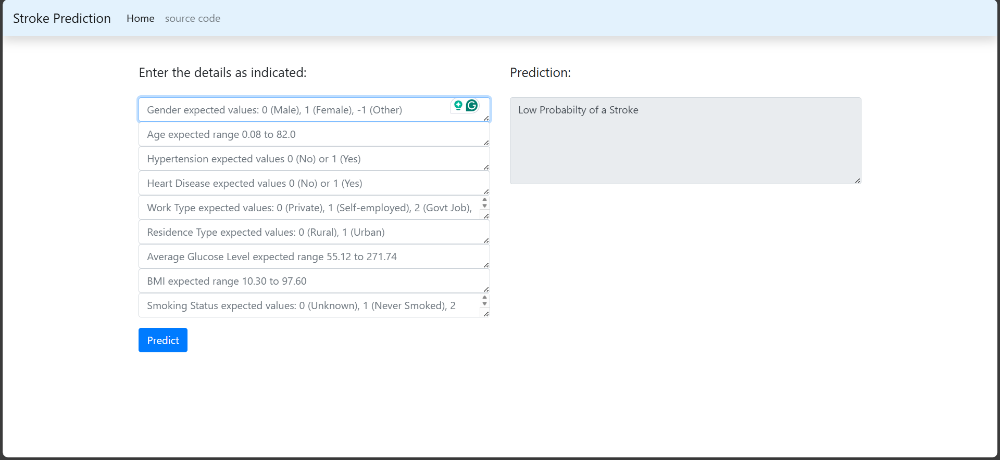
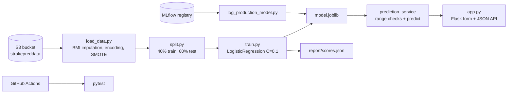

# Stroke Prediction Pipeline

An end-to-end MLOps project that trains a logistic regression model to estimate stroke risk from nine patient attributes, runs as a DVC pipeline with MLflow model tracking, and serves predictions through a Flask web form and JSON API.



## Overview

The data is a 5,110-row healthcare table with 249 stroke cases (4.9%) and 201 missing BMI values. A three-stage DVC pipeline downloads the CSV from S3, fills missing BMI with an XGBoost regressor, encodes the categorical columns as integers, balances the classes with SMOTE, splits the data and trains a logistic regression model. The trained model is copied into a small prediction service that checks every input against allowed ranges before predicting. A Flask app exposes that service as a web form and a JSON endpoint, and GitHub Actions runs the pytest suite on pushes and pull requests to `main`.

## Highlights

- Three DVC stages (`load_data`, `split_data`, `train`) in `dvc.yaml`, with all paths and hyperparameters in `params.yaml`.
- Missing BMI is predicted by an `XGBRegressor` (200 trees, depth 5) trained on the rows that have BMI (`src/load_data.py`).
- Input validation against per-feature minimum and maximum values in `prediction_service/schema_in.json`, raising `NotInRange` or `NotInCols` errors.
- `src/log_production_model.py` promotes the MLflow run with the lowest MAE to Production in the model registry and moves the other versions to Staging.
- 6 pytest tests in `tests/test_config.py` cover valid input, out-of-range values and wrong column names, run through tox and GitHub Actions.

## Architecture



## Results

Two sets of saved numbers exist, and they measure different things.

**Pipeline test split** (`report/scores.json`). The pipeline applies SMOTE before splitting, so this test set is class-balanced and includes synthetic stroke rows. `train.py` scores the 0/1 predictions with regression metrics:

| Metric | Value |
|---|---|
| RMSE | 0.441 |
| MAE | 0.194 (with 0/1 labels, this is the share of wrong predictions) |
| R² | 0.223 |

**Held-out test on the real class balance** (`notebooks/src.ipynb`, saved cell outputs). Here SMOTE is applied to the training part only, and the 30% test split keeps the original mix: 1,533 people, 89 of them with a stroke.

| Model | Accuracy | Stroke precision | Stroke recall | Stroke F1 |
|---|---|---|---|---|
| Logistic regression (C=0.1, scaled) | 0.784 | 0.15 | 0.60 | 0.243 |
| Random forest | 0.886 | 0.14 | 0.19 | 0.163 |

For reference, always predicting "no stroke" would score 0.951 accuracy (the notebook's "Null Accuracy" output), which is why accuracy alone is a poor measure here. The logistic regression finds 60% of stroke cases, but most of the people it flags did not have one. This is a learning project, not a screening tool.

## Tech stack

Python, pandas, scikit-learn, XGBoost, imbalanced-learn, DVC, MLflow, boto3 (S3), Flask, pytest, tox, GitHub Actions.

## Quickstart

```bash
git clone https://github.com/Kevinjoythomas/Stroke-Prediction-Pipeline.git
cd Stroke-Prediction-Pipeline
# xgboost and imbalanced-learn are used by src/load_data.py but are missing from requirements.txt
pip install -r requirements.txt xgboost imbalanced-learn
```

Run the app with the committed model (`prediction_service/model/model.joblib`):

```bash
python app.py   # http://localhost:5000, Flask debug server
```

JSON request. Keys must be sent in this order, which is the training column order:

```bash
curl -X POST http://localhost:5000/ -H "Content-Type: application/json" \
  -d '{"gender":1,"age":80,"hypertension":1,"heart_disease":1,"work_type":1,"Residence_type":1,"avg_glucose_level":271.74,"bmi":35.0,"smoking_status":3}'
```

The answer is `{"response": 0}` or `{"response": 1}`. Categorical fields use the integer codes shown in the form, for example gender 0 = male, 1 = female, -1 = other (see `src/load_data.py`).

Run the tests from the repo root:

```bash
PYTHONPATH=. pytest -v
```

Re-run the pipeline:

```bash
export AWS_ACCESS_KEY_ID=...  AWS_SECRET_ACCESS_KEY=...
dvc repro
```

`load_data` downloads the CSV from the S3 bucket named in `params.yaml`, so it needs credentials with access to that bucket. The same CSV is in `data_given/`, but `load_data.py` does not read it.

## Project structure

```
params.yaml                    paths and hyperparameters
dvc.yaml, dvc.lock             pipeline stages and recorded hashes
src/                           get_data, load_data, split, train, log_production_model
prediction_service/            validation, prediction, model.joblib, schema_in.json
app.py, webapp/templates/      Flask app and HTML form
tests/                         pytest suite
notebooks/src.ipynb            exploration, model comparison, held-out results above
data_given/                    source CSV (5,110 rows)
.github/workflows/ci-cd.yaml   CI: install dependencies and run pytest
```

## Limitations and next steps

- SMOTE runs before the train/test split, so the pipeline's own test set contains synthetic stroke rows and its scores overstate real performance. The fix is to split first and resample only the training part, as the notebook does.
- `train.py` reports regression metrics and model promotion picks the lowest MAE. Recall and precision on the stroke class would be the right measures for this problem.
- The CI workflow installs dependencies and runs pytest only; it has no deployment step. `app.py` starts the Flask debug server, which should be replaced by Gunicorn behind a proxy before any public use.
- The committed model was saved with scikit-learn 1.4.2, and newer versions print a warning when loading it.

## License

No license specified yet.
